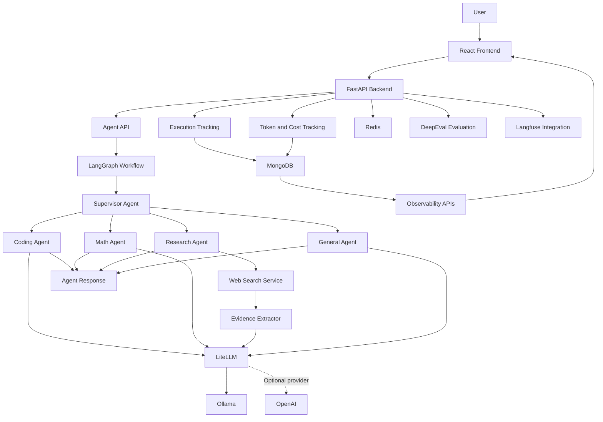

# Intelligent Agent Platform

An intelligent multi-agent platform that automatically classifies user queries and routes them to specialized AI agents. The platform integrates LLMs, research capabilities, agent orchestration, evaluation, observability, token usage tracking, cost monitoring, and an interactive analytics dashboard.

## Project Objectives

- Intelligent query classification and agent routing
- Specialized AI agents for different tasks
- Support for multiple LLM providers through LiteLLM
- Research using official documentation and validated evidence
- Automated agent evaluation
- Execution monitoring and structured logging
- LLM token usage and cost tracking
- Interactive analytics dashboard

## Technology Stack

| Component | Technology |
|---|---|
| Frontend | React + Vite + Tailwind CSS |
| Backend | Python + FastAPI |
| Agent Orchestration | LangGraph |
| LLM Integration | LiteLLM |
| Local LLM | Ollama |
| Evaluation | DeepEval |
| Observability | Langfuse SDK + Custom Monitoring |
| Database | MongoDB |
| Cache | Redis |
| Research Search | Tavily Search API |
| Deployment | Docker |
| Testing | Pytest + Vitest |

## Architecture Overview



## Project Structure

```text
intelligent-agent-platform/
│
├── backend/
│   ├── app/
│   │   ├── agents/
│   │   │   ├── research/
│   │   │   │   └── evidence_extractor.py
│   │   │   ├── coding_agent.py
│   │   │   ├── math_agent.py
│   │   │   ├── research_agent.py
│   │   │   ├── general_agent.py
│   │   │   └── supervisor.py
│   │   │
│   │   ├── api/
│   │   │   └── v1/
│   │   │       └── endpoints/
│   │   │           ├── agents.py
│   │   │           ├── llm.py
│   │   │           └── observability.py
│   │   │
│   │   ├── core/
│   │   ├── database/
│   │   ├── llm/
│   │   ├── orchestration/
│   │   ├── observability/
│   │   ├── cost_tracking/
│   │   ├── schemas/
│   │   └── services/
│   │
│   ├── requirements.txt
│   └── test_*.py
│
├── frontend/
│   ├── src/
│   │   ├── charts/
│   │   │   ├── AgentDistributionChart.jsx
│   │   │   ├── TokenConsumptionChart.jsx
│   │   │   └── ExecutionPerformanceChart.jsx
│   │   ├── hooks/
│   │   │   └── useDashboardData.js
│   │   ├── pages/
│   │   │   └── Dashboard.jsx
│   │   ├── services/
│   │   │   └── api.js
│   │   ├── App.jsx
│   │   └── index.css
│   └── package.json
│
├── docs/
│   ├── architecture/
│   ├── api/
│   └── database/
│
├── docker-compose.yml
├── .env.example
├── .gitignore
└── README.md
```

## Implementation Progress

| Phase | Description | Status |
|---|---|---|
| Phase 1 | Project Foundation – FastAPI, MongoDB, Redis, Docker | Completed |
| Phase 2 | LLM Integration – LiteLLM and Ollama | Completed |
| Phase 3 | Multi-Agent System – LangGraph and specialist agents | Completed |
| Phase 4 | Execution Tracking and Observability APIs | Completed |
| Phase 5 | Token Usage and Cost Tracking | Implemented |
| Phase 6 | Agent Evaluation – DeepEval | Initial implementation |
| Phase 7 | Frontend Monitoring Dashboard | Completed |
| Phase 8 | Testing, Deployment and Final Improvements | In progress |

## Completed Features

### Phase 1 – Project Foundation

- Created the backend project structure using FastAPI.
- Configured application settings using Pydantic Settings.
- Integrated MongoDB for persistent storage.
- Integrated Redis for in-memory data services.
- Configured MongoDB and Redis using Docker Compose.
- Implemented application startup and shutdown lifecycle.
- Created a health-check API to monitor database connections.

### Phase 2 – LLM Integration

- Integrated LiteLLM as a unified LLM interface.
- Connected Ollama as the local LLM provider.
- Integrated the Qwen 2.5 Coder 1.5B model.
- Created a reusable LLM service.
- Implemented provider selection for Ollama and OpenAI.
- Created a FastAPI endpoint for LLM chat.
- Added Pydantic request validation.
- Tested successful requests, invalid providers, empty messages, and default provider selection.

**Available API:**

`POST /api/v1/llm/chat`

**Example Request**

```json
{
  "message": "Explain Java Streams",
  "provider": "ollama"
}
```

**Example Response**

```json
{
  "provider": "ollama",
  "response": "Java Streams allow collection processing using a functional programming style."
}
```

Note: Ollama is currently configured and tested. OpenAI provider credentials and configuration are not yet enabled.

### Phase 3 – Multi-Agent System

- Integrated LangGraph for multi-agent orchestration.
- Implemented a supervisor agent for query classification.
- Added specialist agents:
  - Coding Agent
  - Math Agent
  - Research Agent
  - General Agent
- Implemented conditional routing based on the selected agent.
- Integrated specialist agents with the reusable LLM service.
- Implemented a shared workflow state.
- Added a FastAPI endpoint for agent queries.

**Available API:**

`POST /api/v1/agents/chat`

**Example Request**

```json
{
  "user_query": "Write Java code to find duplicate numbers using Stream API."
}
```

**Example Response Structure**

```json
{
  "selected_agent": "coding",
  "agent_response": "Java Stream API solution..."
}
```

#### Research Agent Capabilities

- Searches official documentation sources.
- Filters unsupported sources.
- Extracts candidate evidence.
- Validates evidence against original source content.
- Implements evidence deduplication and framework-based grouping.
- Generates grounded research comparisons with source references.

Research quality improvements, including broader source coverage, better content extraction, and stronger evidence selection, are reserved for the final polishing phase.

### Phase 4 – Execution Tracking and Observability

- Implemented execution tracking.
- Records execution IDs, queries, selected agents, status, execution duration, and errors.
- Persists execution records in MongoDB.
- Added APIs to retrieve recent executions and individual execution details.
- Implemented recent execution monitoring.

**MongoDB Collection:**

`execution_logs`

**Available APIs:**

| Method | Endpoint | Purpose |
|---|---|---|
| GET | `/api/v1/observability/executions` | Retrieve recent executions |
| GET | `/api/v1/observability/executions/{execution_id}` | Retrieve execution details |

### Phase 5 – Token Usage and Cost Tracking

- Integrated LiteLLM usage extraction.
- Tracks prompt tokens and completion tokens.
- Calculates total token consumption.
- Records estimated provider API cost.
- Associates usage records with agent names and model information.
- Persists usage information in MongoDB.
- Provides usage history and aggregated usage summaries.

**MongoDB Collection:**

`llm_usage`

**Available APIs:**

| Method | Endpoint | Purpose |
|---|---|---|
| GET | `/api/v1/observability/usage` | Retrieve recent LLM usage |
| GET | `/api/v1/observability/usage/summary` | Retrieve aggregated usage statistics |

Note: Local Ollama API cost is recorded as zero because the model runs locally. This does not represent the electricity or hardware cost of local execution.

### Phase 6 – Agent Evaluation

- Integrated DeepEval.
- Created an evaluation workflow for agent responses.
- Added dataset-based evaluation.
- Implemented deterministic evaluation checks.

Current evaluation runs with the LLM judge disabled. Further evaluation metrics, quality analysis, and automated assessment improvements remain part of the next development steps.

### Phase 7 – Frontend Monitoring Dashboard

Implemented a React-based monitoring dashboard using Vite, Tailwind CSS, Axios, Recharts, and Lucide React.

**Dashboard Features**

- Total execution metrics.
- LLM request metrics.
- Total token consumption.
- Estimated API cost.
- Agent activity overview.
- Agent distribution chart.
- Token consumption chart.
- Execution performance chart.
- Recent executions table.
- Recent LLM usage table.
- Dashboard refresh functionality.

**Dashboard Charts**

| Chart | Purpose |
|---|---|
| Agent Distribution | Visualizes execution distribution across agents |
| Token Consumption | Compares prompt and completion tokens by agent |
| Execution Performance | Displays average execution duration by agent |

The frontend retrieves monitoring data from the FastAPI observability APIs.

### Phase 8 – Testing, Deployment and Final Improvements

Current and planned improvements:

- Expand automated backend and frontend testing.
- Improve evaluation quality and coverage.
- Improve research evidence selection and extraction.
- Improve dashboard data accuracy and performance.
- Add detailed execution inspection and error monitoring.
- Optimize frontend bundle size.
- Improve provider configuration and error handling.
- Prepare the application for production deployment.
- Complete end-to-end testing.

## Getting Started

### Prerequisites

- Python 3.12+
- Node.js and npm
- Docker Desktop
- Ollama
- Git

### 1. Clone the Repository

```bash
git clone https://github.com/Pooesh/intelligent-agent-platform.git
cd intelligent-agent-platform
```

### 2. Start MongoDB and Redis

```bash
docker compose up -d
```

### 3. Start Ollama

Ensure Ollama is running and the required model is available:

```bash
ollama pull qwen2.5-coder:1.5b
```

### 4. Configure Environment Variables

Create your local environment file using the example:

```powershell
Copy-Item .env.example backend/.env
```

Update the configuration according to your local environment.

Keep API keys, passwords, and secrets out of Git.

### 5. Set Up the Backend

```powershell
cd backend

python -m venv .venv

.\.venv\Scripts\Activate.ps1

python -m pip install -r requirements.txt
```

If PowerShell blocks virtual environment activation, run:

```powershell
Set-ExecutionPolicy -Scope Process -ExecutionPolicy Bypass
```

### 6. Start FastAPI

```powershell
python -m uvicorn app.main:app --reload
```

Backend API:

`http://localhost:8000`

Swagger documentation:

`http://localhost:8000/docs`

### 7. Set Up the Frontend

Open another terminal:

```powershell
cd frontend

npm install
```

Create a local `.env.local` file:

```env
VITE_API_BASE_URL=http://127.0.0.1:8000/api/v1
```

Start the frontend:

```powershell
npm run dev
```

Frontend dashboard:

`http://localhost:5173`

### 8. Run Frontend Validation

```powershell
npm run lint
npm run build
```

### 9. Run Backend Tests

From the backend directory with the virtual environment activated:

```powershell
pytest
```

## Documentation

### Architecture

- [Application Lifecycle](docs/architecture/application-lifecycle.md)
- [LLM Integration Architecture](docs/architecture/llm-integration.md)
- [Multi-Agent System Architecture](docs/architecture/multi-agent-system.md)
- [Research Agent Architecture](docs/architecture/research-agent.md)

### Database

- [Database Setup](docs/database/database-setup.md)

### API

- [LLM Chat API](docs/api/llm-api.md)
- [Agent API](docs/api/agent-api.md)


- [Observability and Cost Tracking](docs/architecture/observability-and-cost-tracking.md)
- [Frontend Dashboard](docs/architecture/frontend-dashboard.md)


## Future Improvements

- Configure and test additional cloud LLM providers.
- Expand DeepEval evaluation metrics and coverage.
- Complete and verify end-to-end Langfuse tracing.
- Improve token and cost reporting accuracy.
- Add detailed execution inspection and error monitoring.
- Improve frontend performance and visualization.
- Expand research quality and evidence validation.
- Implement production deployment and CI/CD.

## Project Goal

The goal of the Intelligent Agent Platform is to build a modular, extensible, and observable AI system that combines specialized agents, LLM orchestration, evaluation, and monitoring into a unified platform.
