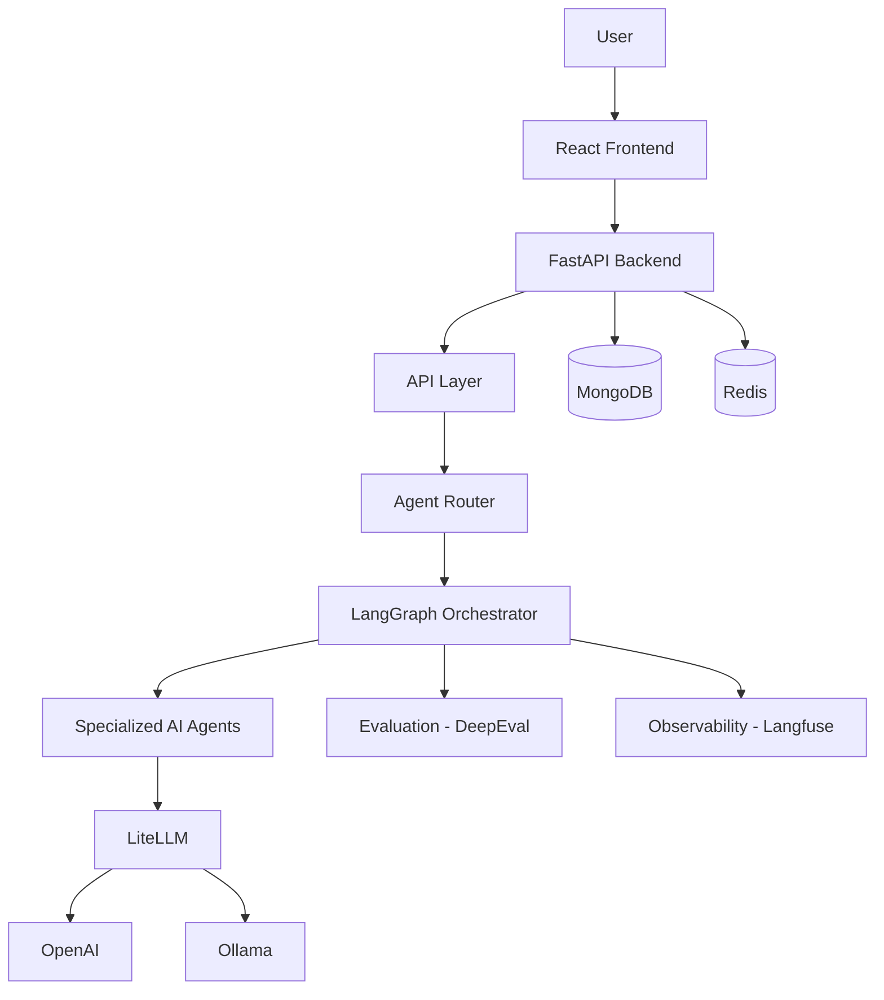

# AI Intelligent Platform

An intelligent multi-agent platform designed to orchestrate AI agents, execute tasks, evaluate responses, and monitor LLM performance through a unified interface.

The project focuses on building a practical AI engineering platform using modern backend technologies, agent orchestration frameworks, LLM integrations, evaluation tools, and observability.

## Project Vision

The goal is to build a platform where users can submit tasks and allow intelligent agents to collaborate to solve them.

The platform will support:

- Multiple AI agents with specialized responsibilities.
- Intelligent task routing and orchestration.
- Integration with multiple Large Language Models.
- Automated evaluation of AI-generated responses.
- LLM monitoring, tracing, and cost tracking.
- A dashboard to visualize agent execution and performance.

## Technology Stack

| Layer | Technology |
|---|---|
| Frontend | React, Tailwind CSS |
| Backend | Python, FastAPI |
| Agent Orchestration | LangGraph |
| LLM Integration | LiteLLM |
| AI Models | OpenAI, Ollama |
| Primary Database | MongoDB |
| Caching | Redis |
| Evaluation | DeepEval |
| Observability | Langfuse |
| Data Visualization | Recharts |
| Containerization | Docker |
| Backend Testing | Pytest |
| Frontend Testing | Vitest |

## High-Level Architecture



*This diagram represents the planned overall architecture. Components will be implemented incrementally.*

## Project Structure

```text
ai-intelligent-platform/
│
├── backend/
│   ├── app/
│   │   ├── agents/
│   │   ├── api/
│   │   │   └── v1/
│   │   │       └── endpoints/
│   │   │           └── health.py
│   │   ├── core/
│   │   │   └── config.py
│   │   ├── cost_tracking/
│   │   ├── database/
│   │   │   ├── mongodb.py
│   │   │   └── redis.py
│   │   ├── evaluation/
│   │   ├── llm/
│   │   ├── models/
│   │   ├── observability/
│   │   ├── orchestration/
│   │   ├── router/
│   │   ├── schemas/
│   │   └── main.py
│   │
│   ├── datasets/
│   ├── tests/
│   │   ├── integration/
│   │   └── unit/
│   ├── requirements.txt
│   └── .env
│
├── frontend/
│   ├── public/
│   └── src/
│       ├── assets/
│       ├── charts/
│       ├── components/
│       ├── hooks/
│       ├── pages/
│       └── services/
│
├── docs/
│   ├── architecture/
│   │   └── application-lifecycle.md
│   ├── database/
│   │   └── database-setup.md
│   ├── api/
│   ├── workflows/
│   ├── development/
│   └── decisions/
│
├── docker-compose.yml
├── .env.example
├── .gitignore
└── README.md
```

## Current Implementation

### Phase 1 – Project Foundation

**Completed**

- Initial project structure created.
- Python virtual environment configured.
- FastAPI backend initialized.
- Environment-based configuration implemented.
- Docker Desktop configured.
- MongoDB 7 container configured.
- Redis 7 container configured.
- Persistent Docker volumes configured.
- Asynchronous MongoDB connection implemented.
- Asynchronous Redis connection implemented.
- FastAPI lifespan integration implemented.
- Application health-check endpoint implemented.
- Architecture and database documentation added.

### Health Check API

**Endpoint**

`GET /api/v1/health`

Example response:

```json
{
    "status": "healthy",
    "application": "AI Intelligent Platform",
    "version": "0.1.0",
    "components": {
        "mongodb": "healthy",
        "redis": "healthy"
    }
}
```

## Getting Started

### Prerequisites

- Python 3.12+
- Docker Desktop
- Git
- Visual Studio Code or another Python IDE

### 1. Clone the repository

```bash
git clone <your-github-repository-url>
cd intelligent-agent-platform
```

### 2. Start infrastructure services

From the project root:

```powershell
docker compose up -d
```

Verify the containers:

```powershell
docker compose ps
```

### 3. Configure the backend

Navigate to the backend:

```powershell
cd backend
```

Create and activate the virtual environment:

```powershell
python -m venv .venv
```

```powershell
.\.venv\Scripts\Activate.ps1
```

Install dependencies:

```powershell
python -m pip install -r requirements.txt
```

Create your local `.env` file using the example configuration and update any required values.

### 4. Start FastAPI

```powershell
python -m uvicorn app.main:app --reload
```

### 5. Access the application

| Resource | URL |
|---|---|
| Backend | http://127.0.0.1:8000 |
| Swagger UI | http://127.0.0.1:8000/docs |
| Health Check | http://127.0.0.1:8000/api/v1/health |

## Project Roadmap

| Phase | Description | Status |
|---|---|---|
| 1 | Project Foundation and Infrastructure | In progress |
| 2 | LLM Integration – OpenAI and Ollama | Planned |
| 3 | Multi-Agent System using LangGraph | Planned |
| 4 | AI Response Evaluation using DeepEval | Planned |
| 5 | Observability and Cost Tracking | Planned |
| 6 | Frontend Dashboard | Planned |
| 7 | Testing, Dockerization and Deployment | Planned |

## Documentation

Detailed project documentation is maintained in the `docs/` directory.

- `docs/architecture/` – Application architecture and lifecycle.
- `docs/database/` – Database design and setup.
- `docs/api/` – API specifications.
- `docs/workflows/` – Application and agent workflows.
- `docs/development/` – Development setup and roadmap.
- `docs/decisions/` – Architecture and technology decisions.

## Development Philosophy

This project is being developed incrementally.

Each phase focuses on:

1. Understanding the problem and architecture.
2. Designing the required components.
3. Implementing functionality step by step.
4. Testing individual modules.
5. Documenting implementation decisions.
6. Integrating components into the overall platform.

## Future Vision

The long-term goal is to develop a practical AI engineering platform that demonstrates multi-agent orchestration, model flexibility, evaluation, observability, and production-oriented backend engineering.
