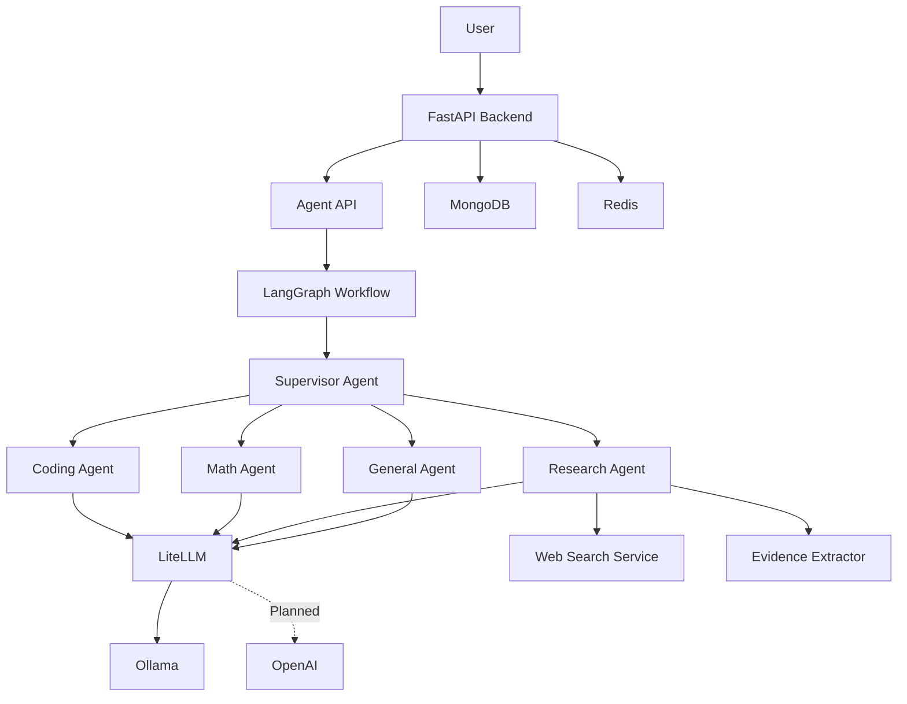

# Intelligent Agent Platform

An intelligent multi-agent platform that automatically classifies user queries and routes them to specialized AI agents. The platform integrates LLMs, research capabilities, and agent orchestration, with evaluation, observability, and cost tracking planned as subsequent phases.

## Project Objectives

- Intelligent query classification and agent routing
- Specialized AI agents for different tasks
- Support for multiple LLM providers through LiteLLM
- Research using official documentation and validated evidence
- Automated agent evaluation
- Monitoring and structured logging
- LLM token usage and cost tracking
- Interactive analytics dashboard

## Technology Stack

| Component | Technology |
|---|---|
| Frontend | React + Vite + Tailwind CSS |
| Backend | Python + FastAPI |
| Agent Orchestration | LangGraph |
| LLM Integration | LiteLLM |
| Local LLM | Ollama |
| Evaluation | DeepEval (planned) |
| Observability | Langfuse (planned) |
| Database | MongoDB |
| Cache | Redis |
| Research Search | Tavily Search API |
| Deployment | Docker |
| Testing | Pytest + Vitest |

## Architecture Overview



> Note: The FastAPI backend, Ollama integration, LangGraph orchestration, specialist agents, and initial research pipeline are implemented. Evaluation, observability, cost tracking, and the frontend are planned.

## Project Structure

```text
intelligent-agent-platform/
�
+-- backend/
�   +-- app/
�   �   +-- agents/
�   �   �   +-- research/
�   �   �   �   +-- evidence_extractor.py
�   �   �   +-- coding_agent.py
�   �   �   +-- math_agent.py
�   �   �   +-- research_agent.py
�   �   �   +-- general_agent.py
�   �   �   +-- supervisor.py
�   �   �
�   �   +-- api/
�   �   �   +-- v1/
�   �   �       +-- endpoints/
�   �   �           +-- agents.py
�   �   �           +-- llm.py
�   �   �
�   �   +-- core/
�   �   +-- database/
�   �   +-- llm/
�   �   +-- orchestration/
�   �   �   +-- graph.py
�   �   �   +-- state.py
�   �   �   +-- first_workflow.py
�   �   �
�   �   +-- schemas/
�   �   +-- services/
�   �       +-- web_search_service.py
�   �
�   +-- requirements.txt
�   +-- test_*.py
�
+-- frontend/
�
+-- docs/
�   +-- architecture/
�   �   +-- application-lifecycle.md
�   �   +-- llm-integration.md
�   �   +-- multi-agent-system.md
�   �   +-- research-agent.md
�   �
�   +-- database/
�   �   +-- database-setup.md
�   �
�   +-- api/
�       +-- llm-api.md
�       +-- agent-api.md
�
+-- docker-compose.yml
+-- .env.example
+-- .gitignore
+-- README.md
```

## Implementation Progress

| Phase | Description | Status |
|---|---|---|
| Phase 1 | Project Foundation � FastAPI, MongoDB, Redis, Docker | Completed |
| Phase 2 | LLM Integration � LiteLLM and Ollama | Completed |
| Phase 3 | Multi-Agent System � LangGraph and Research Agent | Completed |
| Phase 4 | Agent Evaluation � DeepEval | Upcoming |
| Phase 5 | Observability � Langfuse | Upcoming |
| Phase 6 | LLM Usage and Cost Tracking | Upcoming |
| Phase 7 | Frontend Dashboard � React and Tailwind CSS | Upcoming |
| Phase 8 | Testing, Deployment and Final Improvements | Upcoming |

## Completed Features

### Phase 1 � Project Foundation

- Created the backend project structure using FastAPI.
- Configured application settings using Pydantic Settings.
- Integrated MongoDB for persistent storage.
- Integrated Redis for caching.
- Configured MongoDB and Redis using Docker Compose.
- Implemented application startup and shutdown lifecycle.
- Created a health-check API to monitor database connections.

### Phase 2 � LLM Integration

- Integrated LiteLLM as a unified LLM interface.
- Connected Ollama as the local LLM provider.
- Integrated the Qwen 2.5 Coder 1.5B model.
- Created a reusable LLM service.
- Implemented provider selection for Ollama and OpenAI.
- Created a FastAPI endpoint for LLM chat.
- Added Pydantic request validation.
- Tested successful requests, invalid providers, empty messages, and default provider selection.

**Available API:**

`POST /api/v1/llm/chat`

**Example Request**

```json
{
  "message": "Explain Java Streams",
  "provider": "ollama"
}
```

**Example Response**

```json
{
  "provider": "ollama",
  "response": "Java Streams allow collection processing using a functional programming style."
}
```

> Note: Ollama is currently working. OpenAI provider configuration and API key setup are pending.

### Phase 3 � Multi-Agent System and Research Agent

- Integrated LangGraph for multi-agent orchestration.
- Implemented a supervisor agent for query classification.
- Added specialist agents:
  - Coding Agent
  - Math Agent
  - Research Agent
  - General Agent
- Implemented conditional routing based on the selected agent.
- Integrated specialist agents with the reusable LLM service.
- Implemented Tavily-based research search.
- Added official documentation source filtering.
- Implemented evidence extraction using Ollama.
- Added deterministic exact-match evidence validation.
- Implemented evidence deduplication and framework-based grouping.
- Generated grounded research comparisons with source references.
- Added a FastAPI endpoint for agent queries.

**Available API:**

`POST /api/v1/agents/chat`

**Example Request**

```json
{
  "user_query": "Compare LangGraph, CrewAI, and AutoGen based on their official documentation."
}
```

**Example Response Structure**

```json
{
  "selected_agent": "research",
  "agent_response": "Research comparison with supporting source references..."
}
```

**Current Research Capabilities**

- Searches official documentation sources.
- Filters unsupported sources.
- Extracts candidate evidence.
- Validates evidence against original source content.
- Generates comparisons when validated evidence is available for all three frameworks.

> Note: Research quality improvements, including broader source coverage, better content extraction, and stronger evidence selection, are reserved for the final polishing phase.

## Documentation

### Architecture

- [Application Lifecycle](docs/architecture/application-lifecycle.md)
- [LLM Integration Architecture](docs/architecture/llm-integration.md)
- [Multi-Agent System Architecture](docs/architecture/multi-agent-system.md)
- [Research Agent Architecture](docs/architecture/research-agent.md)

### Database

- [Database Setup](docs/database/database-setup.md)

### API

- [LLM Chat API](docs/api/llm-api.md)
- [Agent API](docs/api/agent-api.md)

## Getting Started

### Prerequisites

- Python 3.12+
- Docker Desktop
- Ollama
- Git

### 1. Clone the Repository

```bash
git clone https://github.com/Pooesh/intelligent-agent-platform.git
cd intelligent-agent-platform
```

### 2. Start MongoDB and Redis

```bash
docker compose up -d
```

### 3. Start Ollama

Make sure Ollama is running and the required model is available:

```bash
ollama pull qwen2.5-coder:1.5b
```

### 4. Configure Environment Variables

Create your local `.env` file using the example:

```powershell
Copy-Item .env.example backend/.env
```

Update the environment variables according to your local configuration. Keep API keys and secrets out of Git.

### 5. Set Up the Backend

```powershell
cd backend

python -m venv .venv

# Windows PowerShell
.\.venv\Scripts\Activate.ps1

python -m pip install -r requirements.txt
```

### 6. Start FastAPI

```powershell
python -m uvicorn app.main:app --reload
```

### 7. Open API Documentation

Visit:

http://localhost:8000/docs

Available endpoints include:

- `GET /api/v1/health`
- `POST /api/v1/llm/chat`
- `POST /api/v1/agents/chat`

## Future Enhancements

- Configure and test OpenAI as an additional LLM provider.
- Implement automated agent evaluation using DeepEval.
- Add observability and tracing using Langfuse.
- Implement token usage and cost tracking.
- Build an interactive analytics dashboard.
- Add comprehensive automated testing.
- Containerize and deploy the complete application using Docker.