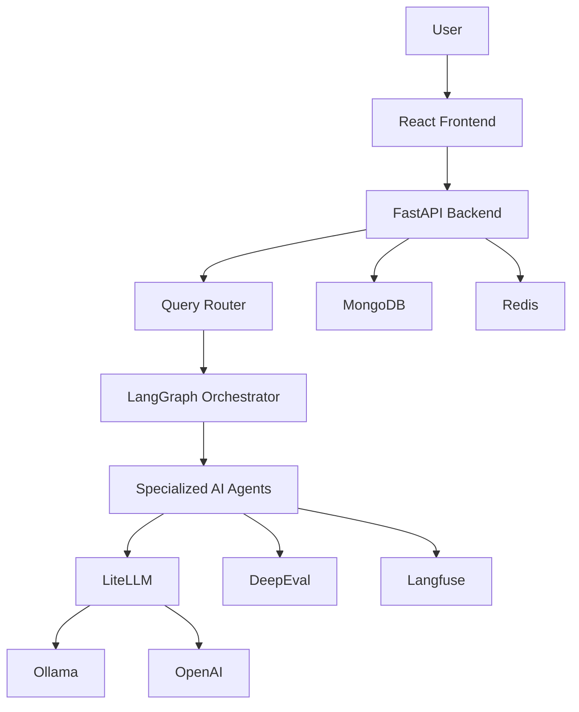

# Intelligent Agent Platform

An intelligent multi-agent platform that automatically routes user queries to specialized AI agents, evaluates their performance, monitors execution, and tracks LLM usage and costs.


## Project Objectives

- Intelligent query classification and agent routing
- Specialized AI agents for different tasks
- Support for OpenAI and Ollama
- Automated agent evaluation
- Monitoring and structured logging
- LLM token usage and cost tracking
- Interactive analytics dashboard

## Technology Stack

| Component | Technology |
|---|---|
| Frontend | React + Vite + Tailwind CSS |
| Backend | Python + FastAPI |
| Agent Orchestration | LangGraph |
| LLM Integration | LiteLLM |
| Evaluation | DeepEval |
| Observability | Langfuse |
| Database | MongoDB |
| Cache | Redis |
| Deployment | Docker |
| Testing | Pytest + Vitest |

## Architecture Overview




> Note: This diagram represents the target architecture. Currently, the project foundation and Ollama-based LLM integration are implemented. Other components will be developed incrementally.

## Project Structure

```text
intelligent-agent-platform/
│
├── backend/
│   ├── app/
│   │   ├── agents/
│   │   ├── api/
│   │   ├── core/
│   │   ├── cost_tracking/
│   │   ├── database/
│   │   ├── evaluation/
│   │   ├── llm/
│   │   ├── models/
│   │   ├── observability/
│   │   ├── orchestration/
│   │   ├── router/
│   │   └── schemas/
│   │
│   ├── datasets/
│   ├── tests/
│   └── requirements.txt
│
├── frontend/
│   ├── public/
│   └── src/
│
├── docs/
│   ├── architecture/
│   ├── database/
│   ├── api/
│   ├── workflows/
│   ├── development/
│   └── decisions/
│
├── docker-compose.yml
├── .env.example
├── .gitignore
└── README.md
```

## Implementation Progress

| Phase | Description | Status |
|---|---|---|
| Phase 1 | Project Foundation – FastAPI, MongoDB, Redis, Docker | Completed |
| Phase 2 | LLM Integration – LiteLLM and Ollama | Completed |
| Phase 3 | Multi-Agent System – LangGraph | Upcoming |
| Phase 4 | Agent Evaluation – DeepEval | Upcoming |
| Phase 5 | Monitoring and Cost Tracking – Langfuse | Upcoming |
| Phase 6 | Frontend Dashboard – React and Tailwind CSS | Upcoming |
| Phase 7 | Testing and Deployment | Upcoming |

## Completed Features

### Phase 1 – Project Foundation

- Created the backend project structure using FastAPI.
- Configured application settings using Pydantic Settings.
- Integrated MongoDB for persistent storage.
- Integrated Redis for caching.
- Configured MongoDB and Redis using Docker Compose.
- Implemented application startup and shutdown lifecycle.
- Created a health-check API to monitor database connections.

### Phase 2 – LLM Integration

- Integrated LiteLLM as a unified LLM interface.
- Connected Ollama as the local LLM provider.
- Integrated the Qwen 2.5 Coder 1.5B model.
- Created a reusable LLM service.
- Implemented provider selection for Ollama and OpenAI.
- Created a FastAPI endpoint for LLM chat.
- Added Pydantic request validation.
- Tested successful requests, invalid providers, empty messages, and default provider selection.

**Available API:**

`POST /api/v1/llm/chat`

### Example Request

```json
{
  "message": "Explain Java Streams",
  "provider": "ollama"
}
```

### Example Response

```json
{
  "provider": "ollama",
  "response": "Java Streams allow collection processing using a functional programming style."
}
```

> Note: Ollama is currently working. OpenAI provider configuration and API key setup are pending.

### Documentation

### Architecture

- [Application Lifecycle](docs/architecture/application-lifecycle.md)
- [LLM Integration Architecture](docs/architecture/llm-integration.md)

### Database
- [Database Setup](docs/database/database-setup.md)
- [LLM Chat API](docs/api/llm-api.md)


## Getting Started

### Prerequisites

- Python 3.12+
- Docker Desktop
- Ollama
- Git

### 1. Clone the repository

```bash
git clone https://github.com/Pooesh/intelligent-agent-platform.git
cd intelligent-agent-platform
```

### 2. Start MongoDB and Redis

```bash
docker compose up -d
```

### 3. Start Ollama

Make sure Ollama is running and the required model is available:

```bash
ollama pull qwen2.5-coder:1.5b
```

### 4. Set up the backend

```bash
cd backend

python -m venv .venv

# Windows PowerShell
.\.venv\Scripts\Activate.ps1

python -m pip install -r requirements.txt
```

### 5. Start FastAPI

```bash
python -m uvicorn app.main:app --reload
```

### 6. Open API documentation

Visit:

`http://localhost:8000/docs`

## Future Enhancements

- Implement multi-agent orchestration using LangGraph.
- Integrate OpenAI as an additional LLM provider.
- Implement automated agent evaluation using DeepEval.
- Add observability and cost tracking using Langfuse.
- Build an interactive analytics dashboard.
- Add comprehensive automated testing.
- Containerize and deploy the complete platform.
