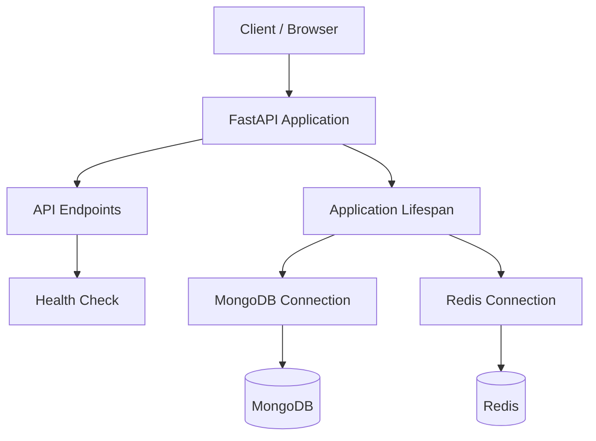
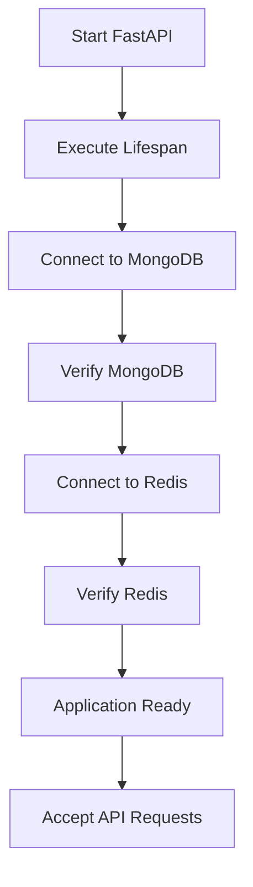
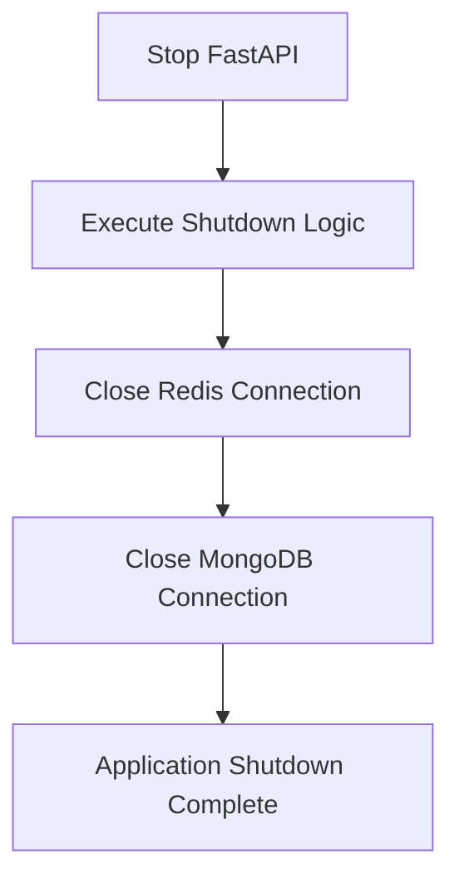

# Application Lifecycle

## 1. Overview

The AI Intelligent Platform uses FastAPI as its backend application framework.

The application manages connections to MongoDB and Redis through FastAPI's lifespan mechanism.

This ensures that database connections are established when the application starts and properly closed when the application shuts down.

## 2. Technology Stack

| Component | Technology | Purpose |
|---|---|---|
| Backend | Python + FastAPI | REST API development |
| Primary Database | MongoDB | Persistent application data |
| Cache | Redis | Temporary data and caching |
| Containerization | Docker | Running infrastructure services |
| API Documentation | Swagger UI | API testing and documentation |

## 3. Application Architecture

The current backend architecture is:



## 4. Application Startup

When FastAPI starts, the lifespan function executes the following operations:

1. Initialize the MongoDB connection.
2. Verify MongoDB connectivity using the ping command.
3. Initialize the Redis connection.
4. Verify Redis connectivity using the ping command.
5. Start accepting application requests.

### Startup Flow



## 5. Application Shutdown

When FastAPI shuts down:

1. Stop accepting new requests.
2. Close the Redis connection.
3. Close the MongoDB connection.
4. Complete application shutdown.

### Shutdown Flow



## 6. Health Check

The platform provides a health-check endpoint:

`GET /api/v1/health`

This endpoint verifies the availability of MongoDB and Redis.

### Healthy Response

```json
{
    "status": "healthy",
    "application": "AI Intelligent Platform",
    "version": "0.1.0",
    "components": {
        "mongodb": "healthy",
        "redis": "healthy"
    }
}
```

### Unhealthy Response

If either database connection fails, the endpoint returns HTTP 503 with the overall application status set to `unhealthy`.

## 7. Important Backend Files

| File | Responsibility |
|---|---|
| `app/main.py` | FastAPI application initialization and lifespan |
| `app/core/config.py` | Application configuration |
| `app/database/mongodb.py` | MongoDB connection management |
| `app/database/redis.py` | Redis connection management |
| `app/api/v1/endpoints/health.py` | Application health-check endpoint |

## 8. Running the Application

Start the backend from the `backend` directory:

```powershell
python -m uvicorn app.main:app --reload
```

Backend URL:

`http://127.0.0.1:8000`

Swagger documentation:

`http://127.0.0.1:8000/docs`

Health check:

`http://127.0.0.1:8000/api/v1/health`

## 9. Current Implementation Status

- FastAPI application configured.
- MongoDB connection implemented.
- Redis connection implemented.
- Application lifespan integration completed.
- MongoDB and Redis connectivity verified.
- Health-check endpoint implemented and tested.

**Status:** Completed as part of Phase 1 – Project Foundation.
