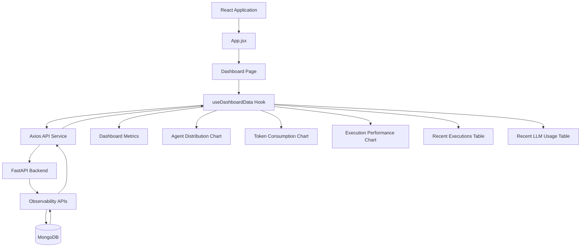

# Frontend Dashboard Architecture

## 1. Overview

The Intelligent Agent Platform includes a React-based monitoring dashboard that provides visibility into AI agent executions, LLM usage, token consumption, estimated API costs, and execution performance.

The frontend communicates with the FastAPI backend through REST APIs and displays monitoring information using interactive charts, metric cards, and data tables.

## 2. Technology Stack

| Component | Technology |
|---|---|
| UI Framework | React |
| Build Tool | Vite |
| Styling | Tailwind CSS |
| HTTP Client | Axios |
| Charts | Recharts |
| Icons | Lucide React |
| Backend Communication | FastAPI REST APIs |

## 3. Frontend Architecture



## 4. Project Structure

```text
frontend/
│
├── public/
│
├── src/
│   ├── charts/
│   │   ├── AgentDistributionChart.jsx
│   │   ├── TokenConsumptionChart.jsx
│   │   └── ExecutionPerformanceChart.jsx
│   │
│   ├── hooks/
│   │   └── useDashboardData.js
│   │
│   ├── pages/
│   │   └── Dashboard.jsx
│   │
│   ├── services/
│   │   └── api.js
│   │
│   ├── App.jsx
│   ├── App.css
│   ├── index.css
│   └── main.jsx
│
├── .env.local
├── package.json
└── vite.config.js
```

Note: `.env.local` is a local configuration file and must not be committed to Git.

## 5. Application Entry Point

The application starts from `main.jsx`.

It imports the global stylesheet and renders the root React component.

`App.jsx` loads the Dashboard page, which serves as the primary monitoring interface.

## 6. API Integration

The Axios service is implemented in:

`src/services/api.js`

The backend base URL is configured using:

```env
VITE_API_BASE_URL=http://127.0.0.1:8000/api/v1
```

The API service exposes functions for:

| Function | Backend Endpoint |
|---|---|
| `getRecentExecutions()` | `/observability/executions` |
| `getExecutionById()` | `/observability/executions/{execution_id}` |
| `getRecentUsage()` | `/observability/usage` |
| `getUsageSummary()` | `/observability/usage/summary` |

## 7. Dashboard Data Management

The custom React hook:

`src/hooks/useDashboardData.js`

is responsible for retrieving and managing dashboard data.

It fetches three data sources:

1. Recent agent executions.
2. Recent LLM usage records.
3. Aggregated LLM usage summary.

The hook manages:

- Execution records
- Usage records
- Usage summary
- Loading state
- Error state
- Dashboard refresh functionality

The dashboard components consume this data through React props.

## 8. Dashboard Visualizations

### 8.1 Metric Cards

The dashboard displays four primary metrics.

| Metric | Description |
|---|---|
| Total Executions | Number of execution records currently loaded |
| LLM Requests | Number of LLM usage records represented in the summary |
| Total Tokens | Combined prompt and completion tokens |
| Estimated API Cost | Estimated provider API cost |

Note: Execution records and recent usage records are currently retrieved using limited result queries. The displayed execution count and recent activity should not be interpreted as lifetime totals.

### 8.2 Agent Distribution Chart

File:

`src/charts/AgentDistributionChart.jsx`

Technology: Recharts PieChart.

Purpose:

Visualizes the distribution of agent executions across:

- Coding Agent
- Math Agent
- Research Agent
- General Agent
- Other recorded agent names

The chart groups execution records using the selected agent name.

### 8.3 Token Consumption Chart

File:

`src/charts/TokenConsumptionChart.jsx`

Technology: Recharts BarChart.

Purpose:

Compares prompt token consumption and completion token consumption across agents.

The chart uses stacked bars to distinguish:

- Prompt Tokens
- Completion Tokens

This helps identify which agents consume more tokens.

### 8.4 Execution Performance Chart

File:

`src/charts/ExecutionPerformanceChart.jsx`

Technology: Recharts BarChart.

Purpose:

Displays average execution duration for each agent.

The average duration is calculated using the execution records currently available to the dashboard.

This helps compare the response performance of different agents.

### 8.5 Recent Executions Table

Displays recent execution information, including:

- Execution ID
- Query
- Selected agent
- Execution status
- Execution duration
- Timestamp

### 8.6 Recent LLM Usage Table

Displays recent model usage information, including:

- Agent name
- Model and provider information when available
- Prompt tokens
- Completion tokens
- Total tokens
- Estimated cost

## 9. End-to-End Data Flow

When a user opens the monitoring dashboard:

1. React renders the Dashboard page.
2. The dashboard data hook initiates API requests.
3. Axios sends requests to the FastAPI observability endpoints.
4. FastAPI retrieves the corresponding records from MongoDB.
5. The API returns execution and usage information.
6. The hook updates React state.
7. Metric cards, charts, and tables render the retrieved data.
8. The user can refresh the dashboard to retrieve updated information.

## 10. Running the Frontend

Navigate to the frontend directory:

```powershell
cd frontend
```

Install dependencies:

```powershell
npm install
```

Create `.env.local`:

```env
VITE_API_BASE_URL=http://127.0.0.1:8000/api/v1
```

Start the development server:

```powershell
npm run dev
```

Open:

`http://localhost:5173`

## 11. Frontend Validation

Run ESLint:

```powershell
npm run lint
```

Create a production build:

```powershell
npm run build
```

## 12. Current Limitations and Future Improvements

- Add pagination and filtering for execution history.
- Add detailed execution inspection.
- Improve historical aggregation and reporting.
- Add error-rate and success-rate visualizations.
- Improve chart filtering by date range and agent.
- Add automated frontend tests.
- Optimize JavaScript bundle size using code splitting.
- Improve dashboard loading and refresh behavior.
- Add more detailed LLM provider and model comparisons.

## 13. Summary

The frontend monitoring dashboard provides a visual interface for understanding the Intelligent Agent Platform's operational activity.

It connects React components, reusable API services, backend observability endpoints, and MongoDB data to present agent execution statistics, token consumption, estimated costs, and execution performance.
