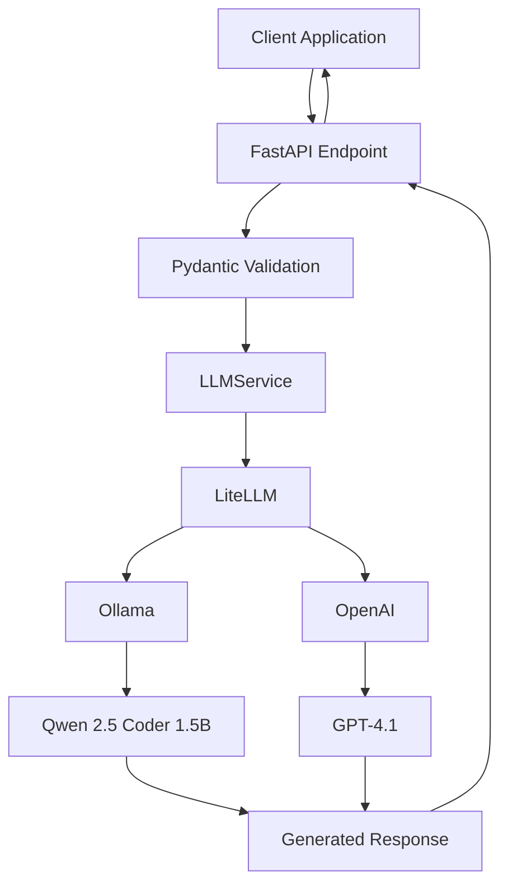

# LLM Integration Architecture

## 1. Overview

The AI Intelligent Platform uses LiteLLM to integrate with multiple Large Language Model (LLM) providers through a unified interface.

The initial implementation uses Ollama with the Qwen 2.5 Coder 1.5B model. OpenAI integration is defined as a future provider option.

## 2. Technology Stack

| Component | Technology |
|---|---|
| Backend API | FastAPI |
| LLM Integration | LiteLLM |
| Local LLM Provider | Ollama |
| Local Model | Qwen 2.5 Coder 1.5B |
| Future Cloud Provider | OpenAI |
| Request Validation | Pydantic |

## 3. Architecture Diagram



## 4. Request Lifecycle

1. The client sends a message through the LLM chat API.
2. FastAPI receives the HTTP request.
3. Pydantic validates the message and provider.
4. LLMService selects the configured model based on the provider.
5. LiteLLM sends the request to the selected LLM provider.
6. The provider generates a response.
7. LLMService extracts the generated text.
8. FastAPI returns the response to the client.

## 5. Provider Configuration

### Ollama

- Provider: Ollama
- Model: qwen2.5-coder:1.5b
- Integration: LiteLLM
- Base URL: http://localhost:11434
- Execution: Local machine

### OpenAI

- Provider: OpenAI
- Configured model: gpt-4.1
- Integration: LiteLLM
- API key: Required
- Status: Not configured yet

## 6. Important Backend Files

```text
backend/app/
├── llm/
│   ├── llm_service.py
│   └── model_config.py
│
├── schemas/
│   └── llm.py
│
└── api/
    └── v1/
        └── endpoints/
            └── llm.py
```

## 7. Design Benefits

- Supports multiple LLM providers.
- Keeps provider-specific configuration separate.
- Uses a unified LLM interface.
- Makes it easier to add new providers.
- Keeps API endpoints independent of provider implementation.

## 8. Current Implementation Status

- FastAPI LLM endpoint: Completed.
- LiteLLM integration: Completed.
- Ollama integration: Completed.
- Qwen model integration: Completed.
- Request validation: Completed.
- OpenAI integration: Pending.
