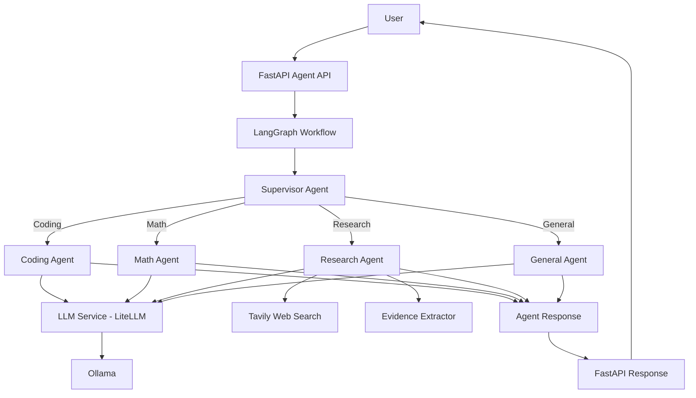

# Multi-Agent System Architecture

## 1. Overview

The Intelligent Agent Platform uses a multi-agent architecture built with **LangGraph**, **FastAPI**, and **LiteLLM**.

The system receives a user query, identifies its category using a Supervisor Agent, and routes it to the appropriate specialist agent.

The platform currently supports four specialist agents:

- Coding Agent
- Math Agent
- Research Agent
- General Agent

Each specialist processes the query using the shared LLM service and the configured Ollama model.

## 2. Architecture



## 3. Main Components

### 3.1 FastAPI Agent Endpoint

The agent API exposes an HTTP endpoint for submitting user queries.

Responsibilities:

- Accept user queries.
- Validate incoming request data.
- Invoke the LangGraph workflow.
- Return the selected agent and its response.
- Handle processing errors.

Endpoint:

`POST /api/v1/agents/chat`

### 3.2 Supervisor Agent

File: `backend/app/agents/supervisor.py`

The Supervisor Agent determines which specialist should handle a query.

It uses a hybrid classification approach.

**First: Rule-based classification**

The supervisor checks the query against keyword groups:

- Coding keywords
- Mathematics keywords
- Research and comparison keywords

**Second: LLM-based classification**

If no rule matches, the supervisor sends a classification prompt to the configured Ollama model.

The expected categories are:

- `coding`
- `math`
- `research`
- `general`

If the LLM returns an unsupported category, the supervisor defaults to `general`.

### 3.3 Specialist Agents

Each specialist has a separate responsibility.

| Agent | Responsibility |
|---|---|
| Coding Agent | Generate code, explain programming concepts, and follow coding best practices |
| Math Agent | Solve mathematical problems, explain calculations, and show formulas |
| Research Agent | Search documentation, extract evidence, and generate evidence-based research responses |
| General Agent | Answer general knowledge questions and explain technical or non-technical concepts |

Each agent uses the shared `LLMService` to generate its response.

### 3.4 LangGraph Orchestration

File: `backend/app/orchestration/graph.py`

LangGraph manages the execution flow.

The workflow contains:

- One Supervisor node.
- Four specialist nodes.
- Conditional routing from the Supervisor.
- An END transition after the selected specialist completes.

Execution flow:

1. The workflow starts.
2. The Supervisor classifies the user query.
3. LangGraph evaluates the selected agent.
4. The query is routed to the matching specialist.
5. The specialist generates a response.
6. The workflow ends and returns its state.

Only one specialist agent is invoked for each query.

### 3.5 Shared Agent State

File: `backend/app/orchestration/state.py`

The workflow uses a shared `AgentState` structure.

| Field | Purpose |
|---|---|
| `user_query` | Original query submitted by the user |
| `selected_agent` | Agent selected by the Supervisor |
| `agent_response` | Response generated by the selected agent |

The shared state allows the Supervisor and specialist nodes to exchange information during workflow execution.

## 4. LLM Integration

The specialist agents and Supervisor use the shared `LLMService`.

The current development configuration uses:

- LiteLLM for LLM integration.
- Ollama as the configured provider.
- A locally hosted model configured through project settings.

This keeps model integration separate from individual agent implementations.

## 5. Project Structure

Relevant Phase 3 files:

```text
backend/
└── app/
    ├── agents/
    │   ├── coding_agent.py
    │   ├── general_agent.py
    │   ├── math_agent.py
    │   ├── supervisor.py
    │   ├── research_agent.py
    │   └── research/
    │       └── evidence_extractor.py
    │
    ├── api/
    │   └── v1/
    │       └── endpoints/
    │           └── agents.py
    │
    ├── orchestration/
    │   ├── state.py
    │   └── graph.py
    │
    ├── schemas/
    │   └── agent.py
    │
    └── services/
        └── web_search_service.py
```

## 6. Error Handling

The FastAPI agent endpoint catches exceptions raised during workflow execution.

When processing fails, the endpoint returns HTTP `502 Bad Gateway` with an error detail.

Invalid request data is handled by FastAPI and Pydantic validation.

## 7. Current Scope

The current implementation provides:

- Supervisor-based query classification.
- Rule-based classification with LLM fallback.
- Four specialist agents.
- Conditional routing through LangGraph.
- Shared LLM integration through LiteLLM.
- A research agent with source filtering and evidence validation.

Future platform improvements include evaluation, observability, token usage tracking, frontend integration, and additional testing.

Research-quality improvements are reserved for the final polishing stage.