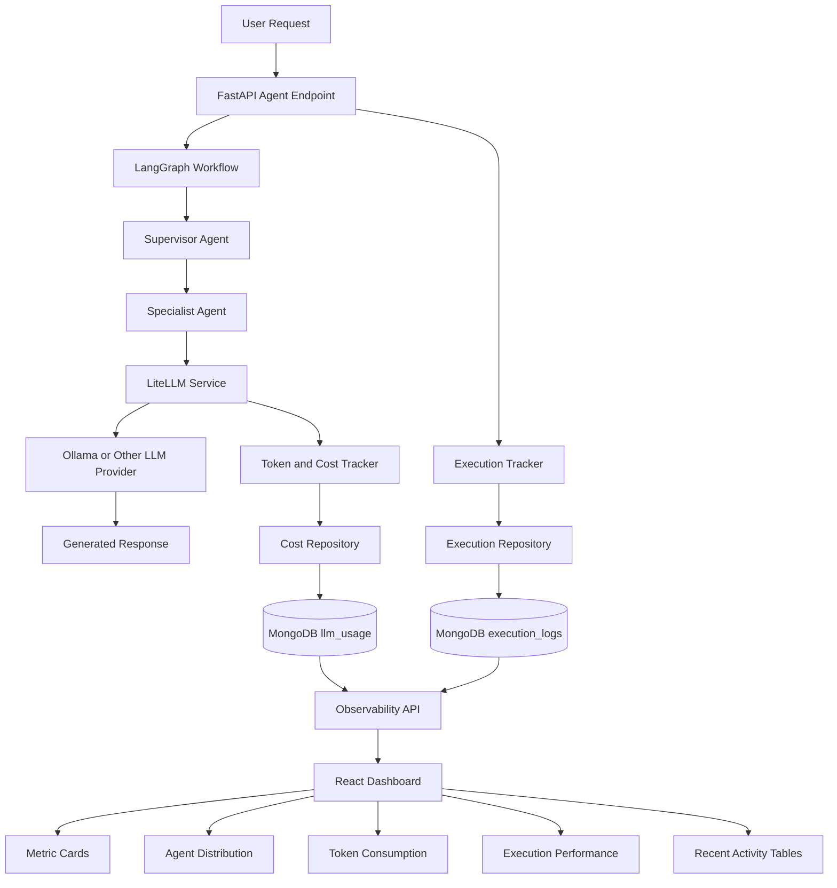

# Observability and Cost Tracking Architecture

## 1. Overview

The Intelligent Agent Platform includes an observability and cost-tracking layer that monitors AI agent executions and LLM usage.

The purpose of this layer is to make the platform measurable and easier to debug by recording execution information, token consumption, estimated provider costs, and execution performance.

The implementation consists of:

- Execution tracking
- MongoDB persistence
- LLM token usage extraction through LiteLLM
- Estimated API cost tracking
- FastAPI observability endpoints
- React monitoring dashboard
- DeepEval evaluation and Langfuse integration points

## 2. Architecture



## 3. Execution Tracking

Execution tracking records information about agent workflow requests.

The execution tracker captures information such as:

| Field | Description |
|---|---|
| Execution ID | Unique execution identifier |
| User Query | Submitted user question |
| Selected Agent | Agent selected by the supervisor |
| Status | Execution status |
| Duration | Execution duration in milliseconds |
| Error | Error information when execution fails |
| Created At | Execution timestamp |

### Execution Flow

1. The FastAPI agent endpoint receives a user query.
2. The execution tracker initializes an execution record.
3. The LangGraph workflow processes the query.
4. The supervisor selects the appropriate specialist agent.
5. The workflow returns a response or records an error.
6. Execution information is persisted in MongoDB.

### MongoDB Collection

`execution_logs`

### Implementation Files

```text
backend/app/observability/
├── execution_tracker.py
└── execution_repository.py
```

## 4. LLM Token Usage and Cost Tracking

The platform uses LiteLLM to communicate with language models and retrieve available usage information.

The cost-tracking layer extracts model usage information after LLM calls.

### Tracked Metrics

| Metric | Description |
|---|---|
| Prompt Tokens | Tokens sent to the model |
| Completion Tokens | Tokens generated by the model |
| Total Tokens | Combined prompt and completion tokens |
| Estimated Cost | Estimated provider API cost |
| Agent Name | Agent associated with the LLM request |
| Model | Model used for the request |
| Provider | LLM provider |

### Cost Tracking Flow

1. A specialist agent calls the reusable LLM service.
2. LiteLLM sends the request to the configured provider.
3. The provider returns the generated response and available usage information.
4. The cost tracker extracts token usage and estimated cost.
5. The cost repository persists the usage record in MongoDB.

### MongoDB Collection

`llm_usage`

### Implementation Files

```text
backend/app/cost_tracking/
├── cost_tracker.py
└── cost_repository.py
```

### Local Model Cost Consideration

The current default configuration uses Ollama with a locally hosted model.

The platform records zero provider API cost for local Ollama requests.

This represents the absence of a provider API charge. It does not represent zero hardware, electricity, or infrastructure cost.

## 5. Observability APIs

The FastAPI observability endpoints provide access to execution history and LLM usage information.

### Execution APIs

| Method | Endpoint | Description |
|---|---|---|
| GET | `/api/v1/observability/executions` | Retrieve recent execution records |
| GET | `/api/v1/observability/executions/{execution_id}` | Retrieve an individual execution |

### LLM Usage APIs

| Method | Endpoint | Description |
|---|---|---|
| GET | `/api/v1/observability/usage` | Retrieve recent LLM usage records |
| GET | `/api/v1/observability/usage/summary` | Retrieve aggregated usage statistics |

### Implementation File

```text
backend/app/api/v1/endpoints/
└── observability.py
```

## 6. Frontend Dashboard Integration

The React dashboard consumes the observability APIs to visualize platform activity.

The frontend uses Axios for HTTP communication and a custom React hook to manage dashboard data.

### Data Flow

1. The dashboard loads.
2. The dashboard data hook requests execution records, usage records, and usage summary information.
3. FastAPI retrieves the corresponding information from MongoDB.
4. The API returns structured responses.
5. React updates its component state.
6. Recharts renders the monitoring visualizations.

### Dashboard Components

| Component | Responsibility |
|---|---|
| Dashboard | Main monitoring page |
| useDashboardData | Fetches and manages dashboard data |
| api.js | Axios API service |
| AgentDistributionChart | Displays agent execution distribution |
| TokenConsumptionChart | Displays token consumption |
| ExecutionPerformanceChart | Displays average execution duration |

### Visualizations

**Agent Distribution**

Displays how executions are distributed across specialist agents.

**Token Consumption**

Compares prompt and completion token usage across agents.

**Execution Performance**

Displays average execution duration by agent.

**Metric Cards**

Display execution counts, LLM request counts, token totals, and estimated API cost.

**Recent Activity Tables**

Display recent execution records and LLM usage information.

## 7. Evaluation and Tracing

### DeepEval

DeepEval is used as the evaluation framework for assessing agent responses.

The current implementation includes dataset-based evaluation and deterministic checks.

The evaluation runner currently uses:

```python
evaluate_dataset(
    max_cases=8,
    run_llm_judge=False
)
```

LLM-judge evaluation is currently disabled. Additional evaluation metrics and automated quality assessment remain future improvements.

### Langfuse

Langfuse is part of the platform's LLM observability stack.

It provides a path toward richer model-call tracing, prompt and response inspection, and performance monitoring.

Its end-to-end tracing coverage and export verification should be validated as part of the final integration work.

## 8. Current Limitations and Future Improvements

- Dashboard totals currently use limited recent-record queries rather than complete lifetime aggregates.
- Usage and execution summaries can be expanded with historical reporting.
- Provider cost reporting can be improved and validated across providers.
- More detailed execution inspection can be introduced.
- Failure-rate and error-distribution visualizations can be added.
- DeepEval metrics and LLM-judge evaluation can be expanded.
- Langfuse tracing coverage can be completed and verified.
- Dashboard refresh and data-fetching performance can be improved.

## 9. Summary

The observability and cost-tracking layer provides visibility into how the Intelligent Agent Platform operates.

It connects execution tracking, LLM usage extraction, MongoDB persistence, FastAPI monitoring endpoints, and a React analytics dashboard.

This makes it possible to monitor agent activity, understand token consumption, investigate execution performance, and build toward production-ready AI operations monitoring.
