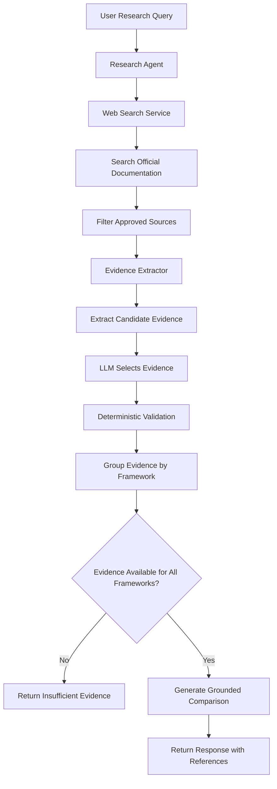

# Research Agent Architecture

## 1. Overview

The Research Agent is a specialist agent in the Intelligent Agent Platform. It handles research-oriented queries by searching official documentation, extracting relevant evidence, validating the evidence, and generating a grounded response using an LLM.

The current implementation focuses on comparing three frameworks:

- LangGraph
- CrewAI
- AutoGen

## 2. Research Workflow



## 3. Web Search Service

File:

`backend/app/services/web_search_service.py`

The Web Search Service uses the Tavily Search API.

It performs searches for:

- Official LangGraph documentation
- Official CrewAI documentation
- Official AutoGen documentation
- The user's original research query

Search results are combined and duplicate URLs are removed.

The current implementation uses basic search depth and configurable result limits.

## 4. Source Validation

File:

`backend/app/agents/research_agent.py`

The Research Agent checks whether a search result belongs to an approved documentation source.

Current approved sources:

| Framework | Approved documentation |
|---|---|
| LangGraph | LangChain official documentation for Python and JavaScript LangGraph |
| CrewAI | `docs.crewai.com` |
| AutoGen | `microsoft.github.io/autogen` |

The implementation also supports selected official GitHub repository paths.

The source validation rejects:

- Non-HTTPS URLs
- Unapproved domains and paths
- GitHub issues, pull requests, discussions, and other non-documentation sections
- Detected archived AutoGen GitHub repository content

Only approved sources are passed to evidence extraction.

## 5. Evidence Extraction

File:

`backend/app/agents/research/evidence_extractor.py`

The Evidence Extractor processes approved documentation content.

Its current responsibilities include:

1. Normalize source URLs.
2. Clean documentation content.
3. Split content into candidate sentences.
4. Send candidate evidence to the LLM.
5. Receive selected source and sentence indexes.
6. Reconstruct the original sentence using Python.
7. Validate the extracted evidence.
8. Remove duplicate evidence.

The LLM selects evidence candidates. Python reconstructs the sentence from the original source content instead of trusting generated sentence text.

## 6. Evidence Validation

The current implementation uses deterministic exact-match validation.

Validation checks include:

- Required evidence fields are present.
- Source indexes are valid.
- Sentence indexes are valid.
- The selected source belongs to the expected framework.
- The reconstructed sentence is supported by the original source content.
- Duplicate evidence is removed.

Validated evidence currently contains:

```json
{
  "verification_status": "exact_match",
  "verification_method": "deterministic"
}
```

This means the sentence was checked against the original source content. It does not mean that a separate semantic verification model has been executed.

A semantic verification method exists in the extractor, but it is not currently part of the active extraction workflow.

## 7. Evidence Grouping

After validation, evidence is grouped by framework:

- LangGraph
- CrewAI
- AutoGen

The Research Agent checks whether all three frameworks have validated evidence.

If any framework has no validated evidence, the agent does not generate the complete comparison.

This prevents the response from presenting an incomplete comparison as if all frameworks were researched.

## 8. Grounded Response Generation

When evidence is available for all frameworks:

1. The Research Agent prepares a comparison prompt.
2. The validated evidence is provided as context.
3. The LLM generates the comparison.
4. Source references are appended to the response.

The generated response is intended to remain grounded in the validated evidence.

## 9. Error Handling

The current pipeline handles situations such as:

- Search results containing unsupported sources.
- Archived or non-documentation GitHub pages.
- Invalid LLM JSON responses.
- Missing or invalid evidence indexes.
- Evidence validation failures.
- Frameworks with no validated evidence.
- Failures during research processing.

The API reports an error when research processing cannot be completed.

## 10. Current Implementation Scope

Implemented:

- Tavily-based web search.
- Official documentation source filtering.
- Evidence extraction using Ollama.
- Deterministic exact-match validation.
- Evidence deduplication.
- Framework-based evidence grouping.
- Grounded comparison generation.
- Source references in the response.

Reserved for final improvement and polishing:

- Better source coverage.
- Improved documentation content extraction.
- Stronger evidence selection.
- Further research quality improvements.

These improvements are intentionally deferred until the final polishing stage.

## 11. Main File Structure

```text
backend/
└── app/
    ├── agents/
    │   ├── research_agent.py
    │   └── research/
    │       └── evidence_extractor.py
    └── services/
        └── web_search_service.py
```