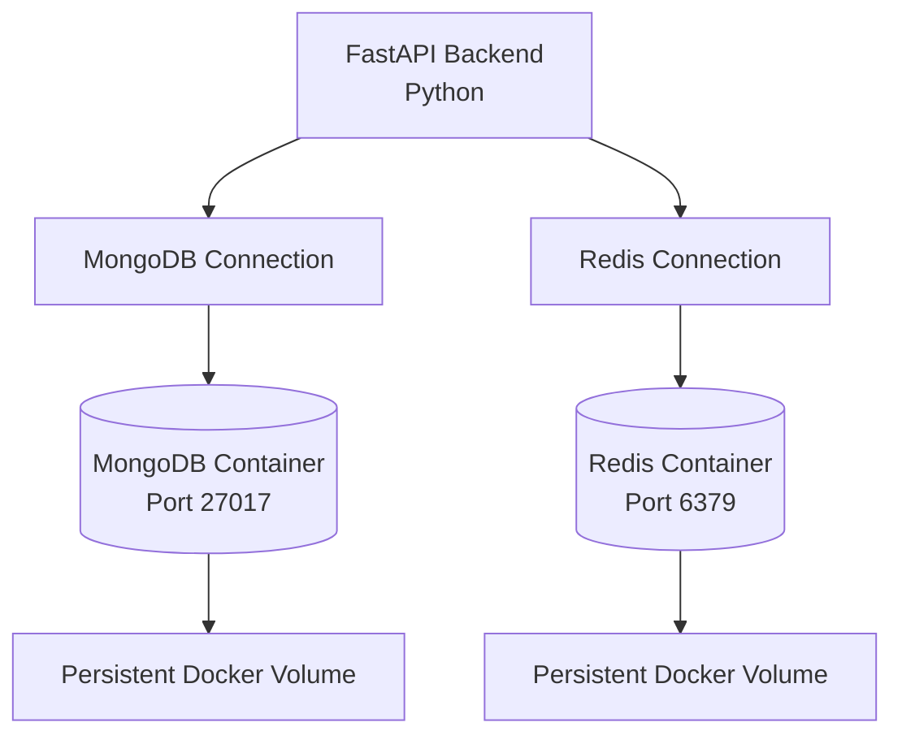

# Database Setup

## 1. Overview

The AI Intelligent Platform currently uses MongoDB as its primary database and Redis as its caching layer.

Both services run inside Docker containers, while the FastAPI backend runs locally during development.

This separation allows the backend and infrastructure services to be managed independently.

## 2. Database Technology

| Component | Technology | Purpose |
|---|---|---|
| Primary Database | MongoDB 7 | Store persistent application data |
| Cache | Redis 7 Alpine | Store temporary and frequently accessed data |
| Containerization | Docker | Run database services in isolated containers |
| Backend | FastAPI | Communicate with MongoDB and Redis |

## 3. Infrastructure Architecture



## 4. Docker Configuration

The project uses a root-level `docker-compose.yml` file to manage MongoDB and Redis.

### MongoDB Service

- Docker image: `mongo:7`
- Container name: `intelligent-agent-mongodb`
- Host port: `27017`
- Container port: `27017`
- Persistent volume: `mongodb_data`

### Redis Service

- Docker image: `redis:7-alpine`
- Container name: `intelligent-agent-redis`
- Host port: `6379`
- Container port: `6379`
- Persistent volume: `redis_data`
- Append-only persistence enabled.

Both services include Docker health checks.

## 5. Environment Configuration

The backend reads its configuration from the `backend/.env` file.

Example configuration:

```env
APP_NAME=AI Intelligent Platform
APP_VERSION=0.1.0
ENVIRONMENT=development
DEBUG=true

API_V1_PREFIX=/api/v1

MONGO_URI=mongodb://localhost:27017
MONGO_DB_NAME=intelligent_agent_platform

REDIS_URL=redis://localhost:6379/0

OLLAMA_BASE_URL=http://localhost:11434

FRONTEND_ORIGINS=http://localhost:5173
```

**Important:** Never commit actual credentials, API keys, or secrets to GitHub. Keep `.env` files excluded through `.gitignore`.

## 6. MongoDB Connection

Implementation file:

`backend/app/database/mongodb.py`

The backend uses PyMongo's asynchronous MongoDB client.

Main responsibilities:

1. Create an asynchronous MongoDB client.
2. Select the application database.
3. Verify connectivity using the MongoDB ping command.
4. Close the client during application shutdown.

Database name:

`intelligent_agent_platform`

## 7. Redis Connection

Implementation file:

`backend/app/database/redis.py`

The backend uses Redis' asynchronous Python client.

Main responsibilities:

1. Create the Redis client.
2. Verify connectivity using the Redis ping command.
3. Close the client during application shutdown.

Redis database index:

`0`

## 8. Starting Infrastructure Services

Run the following commands from the project root.

### Start MongoDB and Redis

```powershell
docker compose up -d
```

### Check container status

```powershell
docker compose ps
```

### Verify MongoDB

```powershell
docker exec intelligent-agent-mongodb mongosh --eval "db.adminCommand('ping')"
```

Expected result:

```text
{ ok: 1 }
```

### Verify Redis

```powershell
docker exec intelligent-agent-redis redis-cli ping
```

Expected result:

```text
PONG
```

### Stop infrastructure services

```powershell
docker compose down
```

Note: `docker compose down` does not remove named volumes by default. Database data is preserved unless the volumes are explicitly removed.

## 9. Application Connectivity

FastAPI manages both database connections using its lifespan mechanism.

During startup:
- Connect to MongoDB.
- Connect to Redis.
- Verify both connections.

During shutdown:
- Close Redis.
- Close MongoDB.

The health-check endpoint is:

`GET /api/v1/health`

It reports the availability of both database services.

## 10. Current Implementation Status

- MongoDB Docker container configured.
- Redis Docker container configured.
- Docker health checks configured.
- Persistent volumes configured.
- MongoDB asynchronous connection implemented.
- Redis asynchronous connection implemented.
- FastAPI database lifecycle integration completed.
- Database health checks tested successfully.

**Status:** Completed as part of Phase 1 – Project Foundation.
